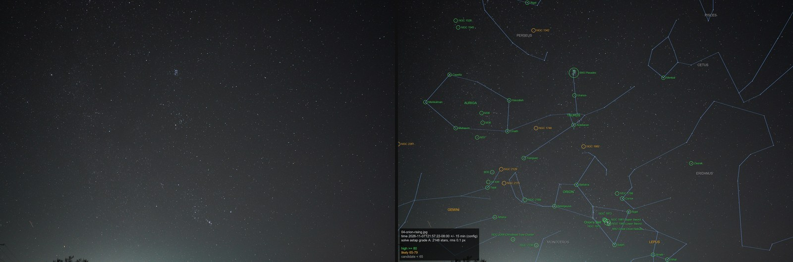
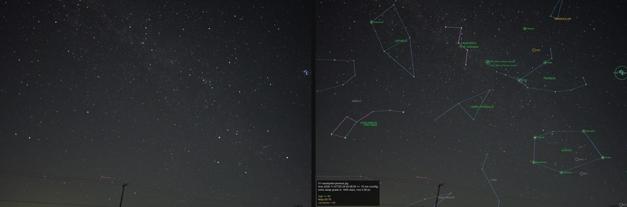
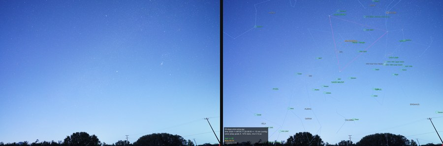
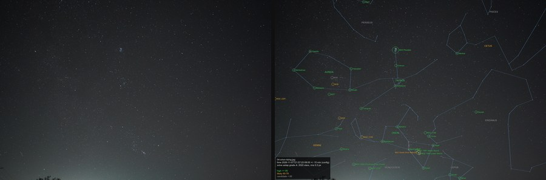
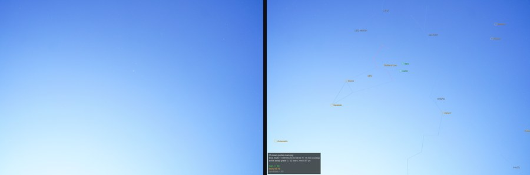

# astro-id

[](LICENSE)
[](https://github.com/raysalem/astro-id/actions/workflows/ci.yml)

**Drop in a night-sky photo and astro-id tells you what is in it: constellations, planets, the Moon, bright
stars and Messier/NGC objects, each with a 0-100 confidence score.**



<!-- Screen recording of the panel inside Facet, to be added later:

-->

## What it does

- **Names what is in the frame** — constellations, the Sun, Moon and planets, IAU-named stars, asterisms and
  Messier/NGC/IC objects, each with a 0-100 confidence score and a tier (high, likely, candidate).
- **Fixes a wrong camera clock** — give it the offset once per folder; when the Moon is in the frame it also
  works out the true capture time from where the Moon sits.
- **Makes photos searchable in Facet** — the objects become tags (`orion`, `jupiter`, `m45 pleiades`) in the
  [Facet](https://github.com/ncoevoet/facet) photo library.
- **Draws sky labels live over the photo** — inside Facet the labels are an overlay you filter by confidence,
  group and magnitude, without solving again.
- **Exports labelled copies** — an annotated JPG per photo plus a CSV report; your originals are never changed.
- **Works offline after setup** — the plate solver and catalogs live on your machine. Nothing is uploaded
  unless you turn on the optional online fallback.

It works standalone from the command line, or as an add-on panel inside Facet.

## Quick start

You need [Python 3.12+](https://www.python.org/downloads/) and [uv](https://docs.astral.sh/uv/getting-started/installation/).

**1. Get astro-id**

```sh
git clone https://github.com/raysalem/astro-id.git
cd astro-id
uv sync
```

**2. Install the ASTAP plate solver and its W08 star database.** [ASTAP](https://www.hnsky.org/astap.htm) is a
free plate solver by Han Kleijn; astro-id calls it to find where in the sky a photo points. W08 is ASTAP's
wide-field star database (fields of about 20 degrees and wider, i.e. wide-angle lenses). All files are on the
[ASTAP download page](https://www.hnsky.org/astap.htm) and the
[astap-program SourceForge project](https://sourceforge.net/projects/astap-program/files/).

<details open>
<summary><b>Windows</b> (per user, no admin rights)</summary>

1. Download `astap_command-line_version_win64.zip` and unzip `astap_cli.exe` into `%LOCALAPPDATA%\astap\`.
2. Download the W08 installer `w08_star_database_mag08_astap.exe` and install it into the same folder:
   ```powershell
   .\w08_star_database_mag08_astap.exe /VERYSILENT /SUPPRESSMSGBOXES /SP- /DIR="$env:LOCALAPPDATA\astap"
   ```

astro-id looks for ASTAP in `ASTAP_PATH`, then `%LOCALAPPDATA%\astap`, `%ProgramFiles%\astap`, then `PATH`.
</details>

<details>
<summary><b>Linux</b> (Debian/Ubuntu; ASTAP also offers .rpm, Arch and .tar.gz builds)</summary>

1. Download `astap_amd64.deb` (or `astap_amd64_gtk3.deb`) and `w08_star_database_mag08_astap.deb`.
2. Install both; they go to `/opt/astap`, where astro-id looks by default:
   ```sh
   sudo apt install ./astap_amd64.deb ./w08_star_database_mag08_astap.deb
   ```
</details>

<details>
<summary><b>macOS</b></summary>

1. Download `astap.pkg` (Intel) or `astap_M1.pkg` (Apple silicon) and `w08_star_database_mag08_astap.pkg`.
2. Right-click each `.pkg` and choose Install (on macOS 15.1 and later, allow it under System Settings, Privacy &
   Security). The star database goes to `/usr/local/opt/astap/`. On Apple silicon, ASTAP asks you to sign it once:
   ```sh
   codesign --force -s - /Applications/ASTAP.app/Contents/MacOS/astap
   ```
3. Tell astro-id where both are:
   ```sh
   export ASTAP_PATH=/Applications/ASTAP.app/Contents/MacOS/astap
   export ASTAP_DB=/usr/local/opt/astap
   ```
</details>

For telephoto shots (fields under about 20 degrees, e.g. 85-200 mm on full frame) also install the **D50**
database the same way.

**3. Download the catalogs and check the setup** (once, needs internet):

```sh
uv run astro-id setup
uv run astro-id check
```

**4. Solve the example photos**

```sh
uv run astro-id solve examples/
```

The terminal shows progress and how many objects each photo solved to. The labelled copies (`<name>_astro.jpg`)
and `astro-id-report.csv`, one row per object with its confidence, land in `examples-annotated/`. Add `--json`
for machine-readable output. Point it at your own photo or folder the same way.

## Examples

| | | |
|---|---|---|
|  |  |  |
|  |  | |

The source photos are in [`examples/`](examples/).

## Use it inside Facet

[Facet](https://github.com/ncoevoet/facet) is a self-hosted photo library. **Add-on support is not in upstream
Facet yet.** It lives on the [`wip/photo-page-layout`](https://github.com/raysalem/facet/tree/wip/photo-page-layout)
branch of [raysalem/facet](https://github.com/raysalem/facet); use that build until it is merged upstream.

Install the add-on once, pointing at Facet's data folder (the one that holds `scoring_config.json`):

```sh
uv run astro-id facet install --facet-data <facet data folder>
```

Then turn on `"addons": {"enabled": true}` in Facet's `scoring_config.json` and restart Facet; "Astro" appears on
its Add-ons page. Open the Astro panel on a folder or a selection of photos, confirm the location and the time,
and press solve: the objects become tags and the sky labels appear over each photo.

With a Facet that has no add-on support, `astro-id facet serve` runs the same steps as a separate local web page
over Facet's HTTP API. Details for both are under [Facet sidecar](#facet-sidecar-astro-id-facet-) and
[Facet add-on](#facet-add-on-sidebar-inside-facet) below.

## How confidence works

astro-id first plate-solves the photo (matches its stars to a catalog), so it knows the sky position of every pixel.
Each object's score multiplies how good that match is, how precisely its spot is pinned, whether it is bright enough
to show in this frame, and how far it sits from the edge and the horizon.
80+ is **high**, 65-79 **likely**, below 65 **candidate**; 65 is the default cut for reports and tags
([details](#confidence-scale)).

## Limits

- **It needs stars.** Cloud, heavy light pollution, daylight or a frame filled by the Moon will not solve.
- **Wide-angle shots need the W08 database**; telephoto shots need D50 as well.
- **Time matters only for the planets, the Moon and the horizon.** Stars, constellations and deep-sky objects are
  found from the stars alone. Without a clock offset, planets and the Moon are capped at *candidate*.
- Wide fields are solved from a central crop and extended outward, so the extreme corners of very wide or
  fisheye lenses may stay unlabelled.

## Requirements

| | Minimum |
|---|---|
| Python | 3.12 |
| uv | any current release |
| ASTAP | command-line solver plus the W08 star database (D50 for telephoto) |
| Facet (optional) | a build with add-on support (see above) |

Run `uv run astro-id check` to verify your setup. The full manual, with every option and the stated minimum
ASTAP and Facet versions, is [docs/MANUAL.md](docs/MANUAL.md).

Formats: [CONTRACT.md](CONTRACT.md) (JSON output, session events, Facet add-on wiring) and
[ANNOTATIONS.md](ANNOTATIONS.md) (the overlay payload).

## Data sources and credits

astro-id stands on the work of others. **No catalog or third-party data file is stored in this repository.**
The catalogs below are downloaded by `astro-id setup` (or on first use) into a per-user cache
(`%LOCALAPPDATA%\astro-id\data` on Windows, `~/.cache/astro-id/data` elsewhere; override with `ASTRO_ID_DATA`).
Each keeps its own license; full notices are in [THIRD_PARTY_NOTICES.md](THIRD_PARTY_NOTICES.md).

| Source | What astro-id uses it for | By | License | How it gets to you |
|---|---|---|---|---|
| [ASTAP](https://www.hnsky.org/astap.htm) | plate solving | Han Kleijn | MPL-2.0 | you install it |
| [ASTAP star databases](https://www.hnsky.org/astap.htm) (W08, D50) | ASTAP's reference stars | Han Kleijn | see the ASTAP site | you install them |
| [Hipparcos Catalogue](https://www.cosmos.esa.int/web/hipparcos/catalogues) (CDS I/239) | star positions and magnitudes | ESA (1997), ESA SP-1200; served by [CDS VizieR](https://vizier.cds.unistra.fr/) | CC BY-NC 3.0 IGO, "Credit: ESA" | downloaded |
| [JPL DE421](https://ssd.jpl.nasa.gov/planets/eph_export.html) ephemeris | Sun, Moon and planet positions | NASA JPL (Folkner et al. 2009) | no license stated; distributed freely by JPL | downloaded via Skyfield |
| [OpenNGC](https://github.com/mattiaverga/OpenNGC) | Messier, NGC and IC objects | Mattia Verga | CC BY-SA 4.0 | downloaded |
| [IAU Catalog of Star Names](https://www.iau.org/public/themes/naming_stars/) ([IAU-CSN.txt](https://www.pas.rochester.edu/~emamajek/WGSN/IAU-CSN.txt)) | star names | IAU Working Group on Star Names (WGSN) | CC BY (IAU) | downloaded |
| [Stellarium](https://stellarium.org/) "modern" sky culture, `constellationship.fab` v23.4 | constellation stick figures | the Stellarium team | CC BY-SA 4.0 + Free Art License | downloaded |
| [astrometry.net](https://nova.astrometry.net/) | optional online fallback solver (off unless you set an API key) | Lang, Hogg et al.; hosted by CANFAR / CADC | web service, their terms | online call |
| [USGS Elevation Point Query Service](https://epqs.nationalmap.gov/) | site elevation (US) in `astro-id site` | U.S. Geological Survey | U.S. public domain, "Credit: U.S. Geological Survey" | online call |
| [timezonefinder](https://github.com/jannikmi/timezonefinder) + data | time zone of the observing site | Jannik Kissinger; data from [timezone-boundary-builder](https://github.com/evansiroky/timezone-boundary-builder) | MIT (code), ODbL (data) | Python dependency |
| [rawpy](https://github.com/letmaik/rawpy) / [LibRaw](https://www.libraw.org/) | decoding RAW files | Maik Riechert / LibRaw LLC | MIT / LGPL-2.1 or CDDL-1.0 | Python dependency |
| [Skyfield](https://rhodesmill.org/skyfield/), [Astropy](https://www.astropy.org/), [NumPy](https://numpy.org/), [SciPy](https://scipy.org/), [Pillow](https://python-pillow.org/), [Requests](https://requests.readthedocs.io/), [MCP SDK](https://github.com/modelcontextprotocol/python-sdk), tzdata | astronomy, WCS, numerics, imaging, HTTP | their authors | MIT, BSD-3-Clause, MIT-CMU, Apache-2.0 | Python dependencies |

The names of the 88 IAU constellations and the asterism definitions (lists of Hipparcos numbers, in
`astro_id/tagpolicy.py`) are part of astro-id's own MIT-licensed code. Map links in the panel open Google Maps or
Google Earth in your browser; astro-id does not fetch data from them.

If you publish results made with astro-id, please credit ESA for Hipparcos, the IAU WGSN for star names,
OpenNGC (Mattia Verga) for deep-sky objects and Stellarium for the constellation figures.

---

## Reference

The sections below are the detailed reference. [docs/MANUAL.md](docs/MANUAL.md) is the user manual.

#### Optional fallback: astrometry.net

Only when ASTAP fails **and** the environment variable `ASTROMETRY_API_KEY` is set, a downscaled
grayscale JPG is uploaded to nova.astrometry.net as a private submission
(`publicly_visible: n`, `allow_commercial_use: n`). The key is read from the environment only and
never written anywhere. `--no-fallback` disables it.

### Command-line usage

```powershell
uv run astro-id solve <file-or-folder> [--min-confidence 65] [--offset +2559d11h08m]
                     [--time-tolerance 15m] [--site lat,lon[,elev_m]]
                     [--overlay-dir DIR] [--json] [--no-overlay] [--no-fallback] [-v]
                     [--tag-levels 1,2,3,4] [--star-mag-limit M] [--max-catalog-mag 6.0]
                     [--tag-style plain|kind] [--stack-mode representative|all] [--stack-gap 120]
                     [--solve-source jpg|raw|auto] [--overlay-scores]
uv run astro-id site <folder>     # pick the observing site on Google Maps -> astro-id.json
uv run astro-id setup             # download data, check ASTAP
```

- A folder is scanned for JPG/JPEG/TIF/PNG and RAW. A RAW file is replaced by its same-stem JPG when
  there is one (RAW+JPG pairs count once); a lone RAW is decoded.
- Overlay labels are plain names ("Uranus"); `--overlay-scores` adds the confidence ("Uranus 100"). The legend keeps
  the tier colour key. The live, filterable overlay is drawn by the Facet viewer from the `annotations` payload
  (see below); the JPG is the static copy.
- Overlays (`<stem>_astro.jpg`, 3000 px wide) and `astro-id-report.csv` go to `--overlay-dir`, default
  the sibling folder `<folder>-annotated`. Originals are never written to.
- `--json` prints one document `{"contract": 1, "results": [...]}` to stdout (see `CONTRACT.md`);
  logs go to stderr. Exit code is 0 when the run completed, even if some frames did not solve.

#### Per-folder settings: `astro-id.json`

```json
{
  "clock_offset": "+2559d11h08m",
  "time_tolerance_min": 15,
  "timezone": "America/Los_Angeles",
  "site": {"name": "Dark site", "lat": 32.6, "lon": -116.3, "elev_m": 1100}
}
```

The nearest `astro-id.json` walking up from each photo's folder applies; command-line flags override it.
`clock_offset` is added to EXIF `DateTimeOriginal` (camera local time) to get the true local time in
`timezone` (system zone when absent). Offsets read like `+2559d11h08m`, `-1h30m`, `90m` or `2559d 11:08`.

`astro-id site <folder>` opens Google Maps in Chrome at the folder's site, asks you to paste
`lat, lon` (right-click the spot in Maps and click the first line to copy it) or a Maps URL, looks up
the elevation from USGS EPQS (US only; you are asked otherwise), asks for a name, confirms, and
writes/merges `astro-id.json` (keeping any clock offset, tolerance and timezone already there).

#### Time and tolerance

Camera clocks drift. Every time-dependent check (planet and Moon positions, above-horizon, horizon
margin) is evaluated across `[t - tolerance, t + tolerance]` and the **worst case** is scored. When the
Moon is found in the frame its position pins the time (it moves ~0.5 deg per hour against the stars):
`best_fit_time` is reported and `time_flag` is set if it falls outside the tolerance. Without an
`astro-id.json` or `--offset`, EXIF time is used as-is (`time_source: "exif"`) and the Sun, Moon and
planets are capped at *candidate*.

### Annotations payload (for the Facet viewer)

Every solved frame result carries `annotations` (null when unsolved): the overlay as data, in the format fixed in
`ANNOTATIONS.md`. All objects at all levels are in it (planets, Moon, Sun, Messier/NGC/IC, asterisms, constellations,
named stars to magnitude 6.5) with their confidence and magnitude, so the viewer filters live by confidence, group
and magnitude without re-solving. Constellation and asterism stick figures are `lines` items: each segment is
sampled along the sky great circle (about every 1.5 degrees), projected through the SIP-corrected solution so it
bends with the lens, clipped to the frame, in full-resolution pixels rounded to 0.1 px. `member_of` is the id of
the group item a star belongs to. The payload stays under 500 KB (lowest-confidence items are dropped first if not).
The legend reads like `2026-11-07 21:57 PST +-15 min . ASTAP grade A . 2452 stars`.

### Quality metrics and culling

Every frame result carries `quality` (CONTRACT.md v1.1): detected and matched star counts, focus as the median
half-flux diameter of isolated unsaturated stars (`fwhm_px`, full-resolution px; equals the FWHM for a sharp star
and measures the disc of a defocused one), trailing as the median elongation (major/minor axis), sky background
and noise, and an A/B/C quality grade. Stars are detected at three smoothing scales; the scale whose kernel matches
the stars is used, so a badly defocused frame is measured on whole discs, not fragments. `--no-quality` skips it
(about 5-15 s per 61 MP frame, mostly JPEG decoding).

`astro_id/cull.py` turns the metrics into `keep | review | reject` with reasons against the session's own
baseline (best-focus quartile, median star count). Defocused frames are `review`, never `reject` (stacking).
The rule is configurable: `{"enabled", "order": ["focus", "trailing", "stars", "solve"], "thresholds": {...}}`
in `astro-id.json` `"cull"` or `--cull-rule`. Nothing writes a photo library's cull flags.

### Astro session (`astro-id session`)

The confirm-then-solve flow for a night's photos, as JSON lines on stdout (schema in CONTRACT.md v1.1):

```powershell
uv run astro-id session --paths-file photos.json --preview --offset +2559d11h08m --tolerance-min 5 --tz America/Los_Angeles
uv run astro-id session --paths-file photos.json --offset +2559d11h08m --tolerance-min 5 --source jpg --save-folder-config
uv run astro-id cull --metrics-file quality.json --cull-rule '{"order": ["focus", "stars"]}'
```

`--preview` reports per photo the EXIF camera time, the corrected time and its window, where the site and
timezone come from, and whether a RAW twin exists, without solving. The solve run emits `start`, one `photo` event
per frame as it finishes (status, objects, grade, quality, best-fit time), and `done` with the session's cull
verdicts and a suggested tighter tolerance when the Moon pinned the time. Per-photo facts a photo library holds
(its GPS, a corrected capture time) are passed as `hints`; the session never reads a library itself. The same
functions are importable (`astro_id.session`).

### RAW as the solver input (`solve_source`)

`jpg` (default) solves the JPG. `raw` solves the same-stem RAW (linear demosaic, camera white balance, no
auto-brightness, half size, channel mean), `auto` uses the RAW when a twin exists. Results always stay in the
JPG pixel space: the RAW is cropped to the JPG frame first. For the Sony A7R IV the decoded area (9568 x 6376)
is cropped to the JPG (9504 x 6336) at the centre (32 px left, 20 px top); that offset was measured by solving
both and agrees to 0.2 px. When a RAW does not map onto its JPG with certainty (different size and no matching
camera crop) the JPG is solved instead and a warning is logged. A lone RAW is always decoded. Measured on
DSC07625 (A7R IV, 14 mm): JPG 1889 matched stars, rms 0.34 px, grade A; RAW 481 stars, rms 0.34 px, grade A;
same 77 objects (41 at >= 65), Jupiter within 0.2 px. RAW is slower (about 26 s vs 20 s) and not better here.

### All options

One table for the engine and `astro-id.json`. Precedence: **command-line flag > nearest `astro-id.json` > default**.
The Facet sidecar passes a photo's own GPS (`--site`) and a date corrected in Facet (`--time`), which override the
file's site and offset.

| Option | Flag | `astro-id.json` | Default |
|---|---|---|---|
| Report cut | `--min-confidence` | - | 65 |
| Camera clock offset | `--offset` | `clock_offset` | none |
| True time of one frame | `--time`, `--timezone` | - | EXIF |
| Time tolerance | `--time-tolerance` | `time_tolerance_min` | 15 min |
| Timezone | `--timezone` (also for EXIF + offset, v1.1) | `timezone` | inferred from the site, else system |
| Site | `--site lat,lon[,elev]` | `site` | none |
| Overlay folder | `--overlay-dir` | - | `<folder>-annotated` |
| Overlay scores | `--overlay-scores` | - | off |
| Skip overlay JPG | `--no-overlay` | - | off |
| Astrometry.net fallback | `--no-fallback` | - | on (needs key) |
| Solver pixels | `--solve-source jpg\|raw\|auto` | `solve_source` | `jpg` |
| Tag levels | `--tag-levels` | `tag_policy.levels` | 1,2,3,4 |
| Star tag limit | `--star-mag-limit` | `tag_policy.star_mag_limit` | off |
| Catalog tag limit | `--max-catalog-mag` | `tag_policy.max_catalog_mag` | 6.0 |
| Tag spelling | `--tag-style` | `tag_policy.tag_style` | `plain` |
| Stacking mode | `--stack-mode` | `stack_mode` | `representative` |
| Stacking gap | `--stack-gap` | `stack_gap_s` | 120 s |
| Stacking tolerance | - | `stack_tolerance` | 0.02 |
| Cull rule | `--cull-rule` (session) | `cull` | built-in (CONTRACT.md) |
| Quality metrics | `--no-quality` | - | on |

### Facet sidecar (`astro-id facet ...`)

astro-id runs beside Facet as its own process and uses only Facet's HTTP API, with its own credential. Nothing is
installed into Facet and Facet's database is not opened (one temporary exception for annotations, below).

```powershell
$env:FACET_URL = "http://127.0.0.1:5000"           # your Facet viewer
$env:FACET_EDITION_PASSWORD = "<edition password>" # or FACET_USERNAME + FACET_PASSWORD (multi-user), or FACET_TOKEN
uv run astro-id facet sync --path-prefix "D:\Photos\2026\trip\astro" --dry-run   # what would be written
uv run astro-id facet sync --path-prefix "D:\Photos\2026\trip\astro"             # solve + write
uv run astro-id facet sync --since last                                            # poll: new astro photos only
uv run astro-id facet serve                                                        # the session web UI
uv run astro-id facet status                                                       # what astro-id wrote where
uv run astro-id facet undo --path-prefix "D:\Photos\2026\trip\astro"             # remove astro-id's tags
```

- **Which photos:** `GET /api/photos` with `--category` (default `astro`; `''` = any), `--path-prefix`, `--tag`,
  `--album`, every frame of a burst included. Photos the ledger already holds are skipped unless `--force`.
  `--since YYYY-MM-DD` narrows by Facet's capture date; `--since last` uses the newest capture date the previous
  sync saw. Facet's API exposes no scan time, so polling = "photos the ledger has not seen yet".
- **What is written:** tags through `POST /api/photos/batch_manual_tags` (`plate-solved` or `plate-solve failed`
  plus the taggable objects, under Facet's 50-tag cap, other tags counted first), stale astro-id tags removed with
  `DELETE /api/photo/manual_tags`, and the annotation payload (`ANNOTATIONS.md`). Facet's reject/cull flags are
  never written. Until Facet has plugin-owned tags, these are stored as ordinary user tags.
- **Ledger:** `%LOCALAPPDATA%\astro-id\facet-ledger.sqlite` (Windows) or `$XDG_DATA_HOME/astro-id/` records per
  Facet URL and photo the tags astro-id added, the annotation hash and the Facet version. A re-run removes only
  those tags; a tag someone else put on the photo is never claimed or removed. Re-running on unchanged results
  writes nothing.
- **Annotations:** `PUT /api/photo/annotations` when Facet has it (feature-detected). On a local Facet stack that
  has the `photo_annotations` table but not the route yet, `--legacy-db <db> --facet-dir <facet checkout>` writes
  them with Facet's own `db/annotations.py` (TEMPORARY). Otherwise they are skipped with a warning.
- **Paths:** the sidecar opens the files at the paths Facet stores; `--path-map FACET_PREFIX=LOCAL_PREFIX` when it
  sees them elsewhere (Facet in Docker).
- **Optional notifier:** `facet_plugin/astro_notify.py.example` appends scored astro paths to a spool file for
  `sync --spool`; not needed.
- **Moving from the old in-process plugin:** `astro-id facet adopt --legacy-db <db>` (TEMPORARY, read-only) puts
  the tags it wrote (`created_by='astro-id'`) and its annotation rows into the ledger once, so the sidecar can
  replace or remove them.

`astro-id facet serve` starts a page on `http://127.0.0.1:<port>/<secret>/` (loopback only, random secret per
start): pick photos (Facet path prefix / album / tag), check each photo's location (Facet GPS, the folder's
astro-id.json site, or none; set one by pasting `lat, lon` or a Google Maps URL, or open the photo in Facet), confirm
the time (camera time, corrected time, offset, tolerance, timezone, JPG/RAW source; optionally save them to the
folder's astro-id.json), plate solve with live progress, then cull: per-frame quality, keep/review/reject with
reasons, an editable rule and re-cull without re-solving. Tagging review/reject frames `astro-review` is optional
and off by default.

### Facet add-on (sidebar inside Facet)

With a Facet that supports add-ons (the add-on boundary spec, `PLUGIN_BOUNDARY.md` v0.2), the same session runs in a
sidebar inside Facet. Facet starts and stops the astro-id process itself; you never run a command, set an env var
or type a password after the one-time install.

**Install (once):**

```powershell
cd C:\path\to\astro-id
uv run astro-id facet install --facet-data "$env:LOCALAPPDATA\Facet\data"
```

This writes `<facet data>\addons\astro-id\addon.json` and nothing else. The manifest holds the absolute path of
`uv` (from `$env:UV`, else `uv` on PATH; `--uv` overrides) and of this checkout (`--project` overrides), so Facet
can start `uv run --project <checkout> astro-id facet serve --addon` without a PATH lookup. Re-run it after moving
the checkout or uv. Then, in Facet's `scoring_config.json`, the operator switch `"addons": {"enabled": true}` must
be on (Facet's setting, off by default; astro-id never edits Facet's config). Facet lists "Astro" on its Add-ons
page after a restart or a config reload.

**Uninstall:** `uv run astro-id facet uninstall --facet-data "$env:LOCALAPPDATA\Facet\data"` (deletes the
manifest and its folder). The ledger and astro-id's tags stay; `astro-id facet undo` removes the tags.

**Use:**

- **After an import:** in Facet's import dialog choose "After import, open: Astro". When the scan finishes, Facet
  offers "Open Astro for N photos"; the sidebar opens on exactly the photos that run saved (step 1 is filled in,
  filtered to category `astro` by default; clear the category box and Reload for every photo of the run).
- **By hand:** open Astro from the Add-ons page or the sidebar; it works on the current view, or on the selected
  photos (up to 500). Step 1 also keeps the manual folder / album / tag loader.
- **The five steps** collapse as you go (location, time ± tolerance and RAW/JPG, plate solve, culling) so they fit
  the narrow sidebar; hover a row for detail. "In Facet" links and the "Show keep / review / reject" buttons ask
  Facet to open or show those photos. After every write, Facet refreshes the photos that changed.
- **What it writes:** tags (as manual tags + astro-id's ledger, until Facet's plugin tags arrive; when Facet
  already has them the sidebar says so), the annotation overlay if Facet has `PUT /api/photo/annotations` (else a
  note in the sidebar says annotations are skipped; there is no `--legacy-db` in add-on mode), and GPS through
  `PUT /api/photo/gps`. Never Facet's cull or reject flags.

**How it is wired (for the curious):** Facet passes `FACET_URL`, `FACET_TOKEN` (a per-launch add-on token),
`FACET_ADDON_ID` and `FACET_LAUNCH_SECRET`. astro-id binds `127.0.0.1` on a free port, prints
`FACET_ADDON_PORT=<n>` (the only line it ever writes to stdout), answers Facet's health challenge with
`HMAC-SHA256(secret, c)` and refuses every other request without `X-Facet-Launch: <secret>`. The page lives at
`/ui/` behind Facet's proxy (`/addons/astro-id/`), in a null-origin sandboxed iframe: no cookies or storage, the
per-open nonce in memory only, thumbnails fetched by astro-id's backend (never straight from Facet). It exits by
itself when Facet stops it or Facet exits. Details: `CONTRACT.md`, section "Facet add-on".

`astro-id facet serve` without `--addon` (the standalone page above) still works and is the way to use astro-id
with a Facet that has no add-on support.

### How it solves

1. The JPG is read at half size and converted to grayscale. Stars are detected at several smoothing
   scales (sharp stars and defocused discs both work).
2. Wide fields (> 35 deg tall): a central ~30 deg crop is binned to ~2 arcmin/px and solved blind by
   ASTAP with W08 and the field size from EXIF. If that fails, larger/offset crops are tried.
   Narrow fields are solved whole.
3. The crop solution is grown to the whole frame: catalog stars are matched outward from the center
   and a TAN-SIP model (up to 4th order) is fitted, with outlier clipping each round, so the corners of
   a 20 mm frame are usable. Projections where the polynomial cannot be trusted are discarded.
4. Grade: **A** = 100+ matched stars and RMS <= 1 px; **B** = 30+ stars and RMS <= 2 px; **C** otherwise
   (RMS in full-resolution pixels).

### Confidence scale

`confidence = 100 x solve quality x position certainty x detectability x margin` (integer, capped at 100)

| Factor | What it measures |
|---|---|
| Solve quality | grade A 1.00, B 0.92, C 0.75 |
| Position certainty | fit residual of the nearest matched stars at that spot (inflated when extrapolating) versus the object's size: `exp(-0.5 (err/size)^2)` |
| Detectability | object magnitude versus the frame's limiting magnitude (the faintest 0.25-mag bin where half the catalog stars are detected), logistic with 0.6 mag softness. Extended objects are dimmed by 2.5 mag per decade of size beyond the star image plus 1.5 mag. A star the fit actually matched scores 1. |
| Margin | partly out of frame (down to 0.4) and worst-case altitude within 3 deg of the horizon (0.6 at 0 deg, 0.4 below) |
| Planets / Moon | x1.1 bonus when a bright source sits at the predicted spot; halved detectability when none does |
| Constellations | in frame when 2+ stick-figure stars are; confidence = solve quality x share of all figure stars detected |

| Tier | Confidence |
|---|---|
| high | >= 80 |
| likely | 65-79 (default `--min-confidence`) |
| candidate | < 65 |

All objects are listed in the JSON and CSV whatever their tier; consumers apply `--min-confidence`.
The overlay colors labels green (high), amber (likely) and gray (candidate); faint NGC/IC candidates
are left off the picture to keep it readable.

### Tag hierarchy and tag policy

A 20 mm frame holds dozens of named stars; tagging all of them buries the interesting objects. Each
object therefore carries a `level`, its `magnitude`, the constellation it lies in (`parent`), the group
that subsumes it (`member_of`) and a `taggable` flag computed from the tag policy:

| Level | What | Tagged by default |
|---|---|---|
| 1 | constellation | yes |
| 2 | Sun, Moon, planet | yes |
| 3 | Messier / NGC / IC object | yes, if magnitude <= `max_catalog_mag` (6.0) |
| 4 | asterism (Orion's Belt, Big Dipper, Summer Triangle, Winter Hexagon, Sickle of Leo, Teapot, W of Cassiopeia, ...) | yes |
| 5 | named star | no; `--star-mag-limit 1.5` tags the ~20 brightest |

- Members are never tagged next to their group: stars inside a tagged cluster's radius (the Pleiades
  stars under `m45 pleiades`) and asterism stars (`orion's belt`, not Alnitak/Alnilam/Mintaka).
- An asterism is found when at least 80 % of its member stars are in frame and detected; its
  confidence is solve quality x that share x horizon margin.
- `--tag-style kind` spells tags `constellation/orion`, `planet/jupiter`, `messier/m45 pleiades`,
  `asterism/orion's belt`, `star/sirius`.
- Per folder: `"tag_policy": {"levels": [1,2,3,4], "star_mag_limit": null, "max_catalog_mag": 6.0, "tag_style": "plain"}`
  in `astro-id.json`; flags override it.
- The JSON, CSV and overlay still list every object. On the overlay asterisms get pink stick figures and
  subsumed member stars a small unlabeled mark.

Asterisms are defined in `astro_id/tagpolicy.py` as lists of Hipparcos ids, written for this project.

### Stacking sequences

Astro shooting comes in bursts. In a folder run, frames taken back to back (gap <= 120 s, same lens,
focal length, exposure and size) form a sequence. The middle frame is plate-solved; every other frame is
registered to it by its star pattern (seconds, no ASTAP). If its pointing moved less than 2 % of the frame
diagonal it reuses the representative's objects, moved into its own pixel frame, and is reported as
`solver: "stack-copy"` with `stack_of`; otherwise it is solved on its own. Soft-focus or otherwise
"bad" frames are not skipped: a frame that registers gets the tags, one that does not is solved alone.
`--stack-mode all` (or `"stack_mode": "all"` in `astro-id.json`) solves every frame; `--stack-gap`
changes the 120 s window.


### Development

```sh
uv run pytest -q
node --test tests/js/bridge.test.js
node --test tests/js/panel.test.js
```

Tests use synthetic frames rendered from Hipparcos through a known WCS (no ASTAP or photos needed,
but the reference data is downloaded on first run).

## License

MIT, copyright (c) 2026 Ray Salem; see [LICENSE](LICENSE). Third-party data and tools keep their own licenses;
see [Data sources and credits](#data-sources-and-credits) and [THIRD_PARTY_NOTICES.md](THIRD_PARTY_NOTICES.md).
