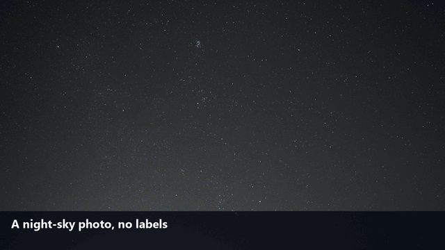
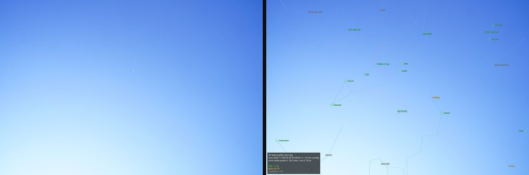
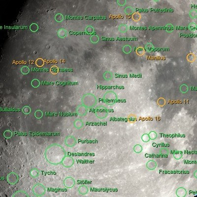

# astro-id

**Point your camera at the sky. astro-id tells you what you caught.**

Every constellation, planet and galaxy in your photo, named and scored. Find Orion, Jupiter or the Pleiades in your
own photos, automatically.

[](LICENSE) [](https://www.python.org/downloads/) [](https://github.com/raysalem/astro-id/actions/workflows/ci.yml)

Works standalone from the command line, or as an add-on inside the [Facet](https://github.com/ncoevoet/facet) photo library.

**Who it's for**

- People who photograph the night sky with a camera on a tripod and want to know what they caught: no telescope or
  star charts needed.
- Photographers who keep a library ([Facet](#use-it-with-facet) users) and want to search photos by what is in the sky.
- Tinkerers who want the results as files (labelled copies, a JSON per photo) or over a documented contract.

<p align="center">
  
  <br><sub>Same photo, before and after astro-id.</sub>
</p>

<p align="center">
  <a href="docs/img/demo.mp4"></a>
  <br><sub>From a plain photo to named objects, and the controls for what is shown. <a href="docs/img/demo.mp4">Full 40 s video (MP4)</a>: setting the location and the clock offset, how approximate they may be, confidence and groups.</sub>
</p>

<table>
  <tr>
    <td width="33%"></td>
    <td width="33%"></td>
    <td width="33%"></td>
  </tr>
  <tr>
    <td><sub>Cassiopeia, Perseus and the Double Cluster.</sub></td>
    <td><sub>Sirius and Orion before dawn.</sub></td>
    <td><sub>Jupiter and Mars in morning twilight.</sub></td>
  </tr>
</table>

More: [the Milky Way through Cepheus](examples/annotated/02-milky-way-cepheus_astro.jpg) and all five [examples](examples/README.md).

## Quick start

Needs Python 3.12+, [uv](https://docs.astral.sh/uv/getting-started/installation/) and the ASTAP plate solver with
its W08 star database ([install them first](#install)). Then:

```sh
git clone https://github.com/raysalem/astro-id.git && cd astro-id
uv sync
uv run astro-id solve examples/
```

The labelled copies, `astro-id-report.csv` and `astro-id-results.json` appear in `examples-annotated/`. Run
`uv run astro-id check` to verify your setup ([requirements](docs/REQUIREMENTS.md)).

**The simplest way** ([docs/SIMPLE.md](docs/SIMPLE.md)): on Windows drag a photo or a folder onto `astro-label.cmd`;
on Linux/macOS run `./astro-label.sh photo.jpg`; or `uv run astro-id label <photo-or-folder>`. Each photo gets a
labelled copy `<name>_astro.jpg` next to it; `--out sidecar` writes `<name>.astro.json` instead, `--out both` writes
both, `--to <folder>` puts them elsewhere.

### Label the Moon

A close-up of the Moon has no stars to solve, so it has its own command:
`uv run astro-id moon <photo> --time 2026-11-20T06:00Z --site 32.6,-116.3`. It finds the disc, works out how the Moon
is turned, and writes `<name>_moon.jpg` with the maria, large craters, mountain ranges and Apollo sites named on the lit
part. The disc must be about 250 px across for craters ([manual](docs/MANUAL.md#photos-of-the-moon-astro-id-moon)).



*Crop of a labeled NASA Moon frame (NASA's Scientific Visualization Studio, public domain); more in [examples/moon](examples/README.md#moon-photos-moon).*

**[Install](#install) · [Usage](#use-it-standalone) · [Confidence](#how-confidence-works) · [Facet add-on](#use-it-with-facet) · [Manual](docs/MANUAL.md)**

## What it does

- **Names what is in the frame:** constellations, Sun, Moon, planets, IAU-named stars, asterisms and Messier/NGC/IC
  objects, each with a 0-100 confidence score.
- **Draws the labels on the photo:** an annotated copy per photo plus a CSV report; originals are never changed.
- **Fixes a wrong camera clock:** set the offset once per folder; the Moon, when in frame, pins the true time.
- **Grades every frame:** focus, trailing and star count, with a keep / review / reject suggestion.
- **Names the Moon's geography (new, first version):** `astro-id moon` labels maria, large craters, mountain ranges
  and Apollo sites on a close-up of the Moon; craters need the disc about 250 px across ([Moon features](docs/REFERENCE.md#moon-features-astro-id-moon)).
- **Tags photos in Facet:** objects become searchable object tags, plus sky labels drawn on the photo.
- **Works offline after setup;** solves JPG or RAW.

## Install

**1. astro-id:** `git clone https://github.com/raysalem/astro-id.git`, then `uv sync` in that folder.

**2. ASTAP and the W08 star database.** [ASTAP](https://www.hnsky.org/astap.htm) (by Han Kleijn) finds where in the
sky a photo points; W08 is its wide-field star database (fields of about 20 degrees and up). Files are on the
[ASTAP page](https://www.hnsky.org/astap.htm) and [SourceForge](https://sourceforge.net/projects/astap-program/files/).
Minimum ASTAP version and the rest: [docs/REQUIREMENTS.md](docs/REQUIREMENTS.md).

Windows (per user, no admin rights): unzip `astap_cli.exe` from `astap_command-line_version_win64.zip` into
`%LOCALAPPDATA%\astap\`, then install W08 into the same folder:

```powershell
.\w08_star_database_mag08_astap.exe /VERYSILENT /SUPPRESSMSGBOXES /SP- /DIR="$env:LOCALAPPDATA\astap"
```

<details>
<summary>Linux (Debian/Ubuntu; ASTAP also offers .rpm, Arch and .tar.gz builds)</summary>

```sh
sudo apt install ./astap_amd64.deb ./w08_star_database_mag08_astap.deb   # both install to /opt/astap
```
</details>

<details>
<summary>macOS</summary>

Install `astap.pkg` (Intel) or `astap_M1.pkg` (Apple silicon) and `w08_star_database_mag08_astap.pkg` (right-click,
Install; on macOS 15.1+ allow them under System Settings, Privacy & Security). On Apple silicon sign ASTAP once,
then tell astro-id where both are:

```sh
codesign --force -s - /Applications/ASTAP.app/Contents/MacOS/astap
export ASTAP_PATH=/Applications/ASTAP.app/Contents/MacOS/astap
export ASTAP_DB=/usr/local/opt/astap
```
</details>

For telephoto shots (field under about 20 degrees, e.g. 85-200 mm on full frame) also install the **D50** database.

**3. Catalogs:** `uv run astro-id setup` downloads the reference data once (needs internet; it exits 3 when ASTAP or
a dataset is missing), then `uv run astro-id check` verifies the whole setup. How ASTAP is found:
[reference](docs/REFERENCE.md#astap-and-reference-data).

## Use it standalone

```sh
uv run astro-id solve <photo-or-folder>              # name the objects, write labelled copies + CSV
uv run astro-id solve <folder> --offset +1h05m       # camera clock was 1 h 05 min slow
uv run astro-id site <folder>                        # pick the observing site on a map -> astro-id.json
uv run astro-id solve <folder> --json > results.json # full results as JSON
```

Labelled copies (`<name>_astro.jpg`), `astro-id-report.csv` (one row per object) and `astro-id-results.json` (the
full per-photo results, the same document `--json` prints) go to `<folder>-annotated/`; `--no-results-file` skips the
JSON file. Runs from the Facet add-on do not write it. Formats and exit codes: [CONTRACT.md](CONTRACT.md).

`astro-id site` suggests the folder's saved site, else the last site you saved on this machine; with neither it asks
for coordinates (or a Google Maps link). Per-folder settings (clock offset, time tolerance, timezone, site) live in
`astro-id.json` next to the photos; flags override it. Every option: [All options](docs/REFERENCE.md#all-options).

## Use it with Facet

Name the sky in your photos. Search them by what's in them.

**Add-on support is not in upstream Facet yet.** It lives on the
[`wip/photo-page-layout`](https://github.com/raysalem/facet/tree/wip/photo-page-layout) branch of
[raysalem/facet](https://github.com/raysalem/facet). Install the add-on once, pointing at Facet's data folder (the
one holding `scoring_config.json`):

```sh
uv run astro-id facet install --facet-data "$env:LOCALAPPDATA\Facet\data"   # Windows (PowerShell)
uv run astro-id facet install --facet-data /path/to/facet/data             # Linux / macOS
```

If Facet refuses the add-on, install again with `--older-facet` (for a Facet that does not know the manifest's
`network` key; the install prints this hint too). Turn on `"addons": {"enabled": true}` in `scoring_config.json` and
restart Facet. Open the Astro panel on a folder or selection, confirm location and time, and solve: objects become
object tags, and sky labels appear on each photo. When its files change, the add-on tries the new version first and
keeps running the previous one if it does not answer. A Facet without add-ons can use the separate web page
`astro-id facet serve` ([Facet sidecar](docs/REFERENCE.md#facet-sidecar-astro-id-facet-)).

## How confidence works

astro-id first plate-solves the photo, matching its stars to a catalog, so it knows where every pixel points.
Each object's score is `100 x solve quality x position certainty x detectability x margin`:

- **Solve quality:** grade A (100+ matched stars, error under 1 px), B or C.
- **Position certainty:** how well the stars around that spot fit, against the object's size.
- **Detectability:** is the object bright enough to show in this frame's sky?
- **Margin:** partly out of frame lowers it; so does sitting near the horizon, but only for objects the fit did not
  match, and only when the time and site are confirmed and the photo agrees with them.

| Tier | Confidence |
|---|---|
| high | 80 and up |
| likely | 65-79 (the default cut for reports and tags) |
| candidate | under 65 |

Full factor table: [Confidence scale](docs/REFERENCE.md#confidence-scale). Which objects become tags:
[Tag hierarchy and tag policy](docs/REFERENCE.md#tag-hierarchy-and-tag-policy).

## Limits

- **It needs stars.** Cloud, a sky too bright to show stars or a frame filled by the Moon will not solve; few
  stars give a grade C. Wide-angle shots need W08; telephoto shots need D50 too.
- **Time and place only matter for the Sun, Moon and planets.** Stars, constellations and deep-sky objects come
  from the plate solve alone, whatever the clock or site says: a wrong clock never removes them. The bodies are
  always computed, but without a clock offset or a confirmed time they are capped at 64 (*candidate*), and without
  a site at 79 (*likely*; the Moon at 70). When a photo's own stars were below the horizon at the recorded time,
  the frame gets a warning that the clock (or site) is wrong. No default site is ever assumed; an estimated site and
  a clock offset with a tolerance are enough.
- **Photos need a long edge of at least about 2400 px**; smaller copies may not solve (details in
  [How it solves](docs/REFERENCE.md#how-it-solves)).
- The extreme corners of very wide or fisheye frames may stay unlabelled.

## Docs

- [Simplest way](docs/SIMPLE.md): `astro-id label` in five lines. [Manual](docs/MANUAL.md): a guided walk-through.
  [Requirements](docs/REQUIREMENTS.md): minimum versions and `astro-id check`. [Testing](docs/TESTING.md): the suites and CI.
- [Reference](docs/REFERENCE.md): every option, `astro-id.json`, time and tolerance, how it solves, confidence, tags,
  quality and culling, astro sessions, RAW input, stacking, the Facet sidecar and add-on, the astrometry.net fallback.
- Formats: [CONTRACT.md](CONTRACT.md) (JSON output, session events, add-on wiring), [ANNOTATIONS.md](ANNOTATIONS.md) (overlay payload).

## Data sources and licenses

Catalogs download on first run; the only third-party data stored in this repository is public domain (a list of
lunar feature positions and one NASA test image). Full credits and terms:
[THIRD_PARTY_NOTICES.md](THIRD_PARTY_NOTICES.md).

| Data or tool | By | License | How |
|---|---|---|---|
| [ASTAP](https://www.hnsky.org/astap.htm) + star databases | Han Kleijn | MPL-2.0 (program) | you install |
| [Hipparcos](https://www.cosmos.esa.int/web/hipparcos/catalogues) | ESA (1997) | CC BY-NC 3.0 IGO, non-commercial | downloaded |
| [JPL DE421](https://ssd.jpl.nasa.gov/planets/eph_export.html) | NASA JPL | distributed freely | downloaded |
| [OpenNGC](https://github.com/mattiaverga/OpenNGC) | Mattia Verga | CC BY-SA 4.0 | downloaded |
| [IAU star names](https://www.iau.org/public/themes/naming_stars/) | IAU WGSN | CC BY | downloaded |
| [Stellarium](https://stellarium.org/) constellation lines | Stellarium team | CC BY-SA 4.0 + Free Art License | downloaded |
| [Lunar feature names](https://planetarynames.wr.usgs.gov/) (92 curated) | IAU WGPSN / USGS; Apollo sites NASA NSSDCA | public domain | in the repo |

Labelled copies carry Stellarium figures and OpenNGC names: credit them if you publish (see the notices).

## Development and license

Tests need no ASTAP or photos (reference data downloads on first run); CI, the example check and how the example
set is rebuilt (`tools/make_examples.py`, `tools/make_demo.py`): [docs/TESTING.md](docs/TESTING.md).

```sh
uv run pytest -q
node --test tests/js/bridge.test.js
node --test tests/js/panel.test.js
```

Code: MIT, copyright (c) 2026 Ray Salem, see [LICENSE](LICENSE). Example photos © Ray Salem. All rights reserved.
They are included to demonstrate and test astro-id; the MIT license does not cover them (see
[examples/README.md](examples/README.md)). Third-party data and tools keep their own licenses.
