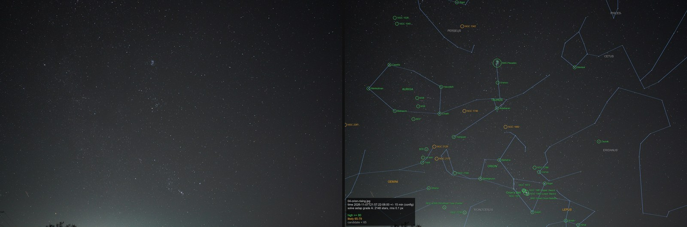
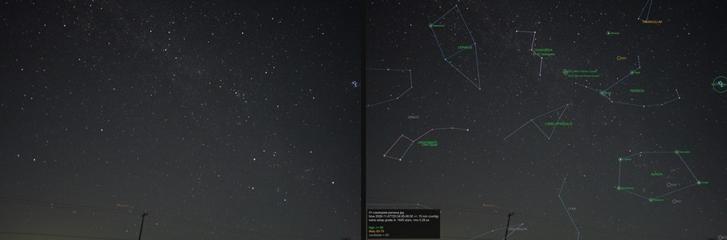

# astro-id manual



## Contents

1. [What it does](#1-what-it-does)
2. [Install and check your setup](#2-install-and-check-your-setup)
   - [The simplest way: astro-id label](#the-simplest-way-astro-id-label)
3. [Your first solve](#3-your-first-solve)
4. [A wrong camera clock](#4-a-wrong-camera-clock)
5. [Your location](#5-your-location)
6. [JPG or RAW](#6-jpg-or-raw)
7. [Labeled copies](#7-labeled-copies)
8. [Inside Facet, end to end](#8-inside-facet-end-to-end)
9. [Updating](#9-updating)
10. [Troubleshooting](#10-troubleshooting)
11. [FAQ](#11-faq)

Commands are shown for PowerShell on Windows. On Linux or macOS the `uv run astro-id ...` commands are the same;
use paths like `~/photos/trip/astro`.

## 1. What it does

- It reads a night-sky photo and works out where the camera was pointing (this is called plate solving).
- It names what is in the frame: constellations, the Sun, Moon and planets, bright stars, Messier/NGC/IC objects, asterisms.
- Every object gets a confidence from 0 to 100.
- It can draw the names on a copy of the photo (the drawn names are called sky labels), or write them into the
  [Facet](https://github.com/ncoevoet/facet) photo library as object tags and sky labels.
- It runs as a command-line tool, or as an "Astro" panel inside Facet. It never changes your original photos.

## 2. Install and check your setup

You need Python 3.12, [uv](https://docs.astral.sh/uv/), the ASTAP solver and an ASTAP star database. Follow the
[README Install section](../README.md#install) for the exact steps; this manual does not repeat them. In short:

```powershell
git clone https://github.com/raysalem/astro-id.git
cd astro-id
uv sync
```

Then install ASTAP and the W08 star database as the README describes (add D50 if you shoot with a telephoto lens).

Check your setup:

```powershell
uv run astro-id check
```

`check` compares your setup against the stated minimums (Python, uv, ASTAP and its star database, and Facet if you
pass `--facet URL`), marks each line, says what to fix, and exits 0 when every required check passes (1 when one
fails). The minimums are listed in [REQUIREMENTS.md](REQUIREMENTS.md). If your copy answers `invalid choice: 'check'`,
update it with `git pull`. `uv run astro-id setup` downloads the reference data (first run only, needs internet),
prints where ASTAP and its databases were found, and exits 3 when ASTAP or a dataset is missing.

### The simplest way: astro-id label

If you only want labeled copies of a few photos, one command (or one drag-and-drop) does it
([SIMPLE.md](SIMPLE.md)):

- **Windows:** drag a photo, several photos or a folder onto `astro-label.cmd` in the astro-id folder.
- **Linux/macOS:** `./astro-label.sh photo.jpg`.
- **Any system:** `uv run astro-id label <photo-or-folder>`.

Each photo gets `<name>_astro.jpg` next to it: a copy with the stick figures and names burned in. The original is
never touched. `--out sidecar` writes `<name>.astro.json` (the objects, confidence, positions and annotations)
instead, `--out both` writes both, and `--to <folder>` puts the results elsewhere. Re-running skips photos that
already have their output. Exit code 0 means labeled (or already done), 1 nothing labeled, 2 a setup or usage
problem. Time and place are optional here too ([sections 4 and 5](#4-a-wrong-camera-clock)).

## 3. Your first solve

The repository ships a small `examples/` folder. Solve it:

```powershell
uv run astro-id solve examples
```

Your own folder works the same way, for example `uv run astro-id solve D:\photos\2026\trip\astro` or
`uv run astro-id solve ~/photos/trip/astro`. A single file works too.

Progress goes to the screen, one line per photo, ending with `done: N/M solved`. Nothing is written next to your
originals. Results go to a sibling folder named `<folder>-annotated` (for example `examples-annotated`; change it
with `--overlay-dir`):

- `<photo>_astro.jpg` - a labeled copy of each frame (see [section 7](#7-labeled-copies)).
- `astro-id-report.csv` - one row per object found, for every frame.
- `astro-id-results.json` - the full results per frame (the same document `--json` prints). A later run replaces only
  the entries of the photos it solved. `--no-results-file` skips it. Runs from the Facet panel never write it.

### Reading the report CSV

Open `astro-id-report.csv` in a spreadsheet. The columns you will use most:

| Column | Meaning |
|---|---|
| `file` | the photo |
| `solved` | whether the frame solved |
| `grade` | how well the whole frame solved: A best, B good, C weakest (from the number of matched stars and how tightly they fit) |
| `object`, `kind` | the name and what it is (constellation, planet, galaxy, ...) |
| `confidence`, `tier` | 0-100 and the tier below |
| `taggable` | whether the object would become a tag under the tag policy |
| `true_time`, `time_source` | the time used, and where it came from (`exif`, `config`, `facet`) |
| `error` | why a frame did not solve |

Every object is listed whatever its confidence; you decide where to cut.

### Reading the JSON

Add `--json` to get one JSON document on the screen (logs go to the error stream, so redirecting is safe):

```powershell
uv run astro-id solve examples --json > solve.json
```

It holds one entry per frame under `results`, each with `solved`, `grade`, `true_time`, `objects`, `warnings`, and
so on. The full field list is in [CONTRACT.md](../CONTRACT.md). `warnings` says, per frame, when no clock offset or
no site was set (and so the Sun, Moon and planets are capped, see sections 4 and 5).

### Exit codes

`solve` exits 0 when the run finished, even if some frames did not solve (they are in the report), and 2 for a usage
error (target not found, a bad flag value, no images). Every command prints its own table at the end of `--help`;
all of them are in [CONTRACT.md](../CONTRACT.md#exit-codes-read-from-the-code-that-returns-them).

### Confidence tiers

| Tier | Confidence | Meaning |
|---|---|---|
| high | 80 and up | sure it is right and visible |
| likely | 65-79 | probably right (the default report cut) |
| candidate | below 65 | possible; check it yourself |

Confidence combines how well the frame solved, how precisely the object's position is known at that spot, how bright
the object is against the faintest stars the photo caught, and whether it is cut by the frame edge. Near the horizon
lowers it only for objects the fit did not match, and only when the time and location are confirmed and the photo
agrees with them.
The full formula is in the [reference](REFERENCE.md#confidence-scale).

On the labeled copies, names are green (high), amber (likely) and gray (candidate).

## 4. A wrong camera clock

Camera clocks drift or were never set. A wrong clock does not stop the solve (the stars fix the pointing on their
own) and never removes stars, constellations or deep-sky objects: those come from the plate solve. It spoils only
the Sun, Moon and planets. They are still identified, but with only the
camera's own time (no offset set) their confidence is capped at 64, "candidate", so they never become object tags at
the default cut. Any offset in `astro-id.json`, even an empty one ("the clock was right"), lifts the cap.

Give the offset: how much to add to the camera's time to get the true time.

```powershell
uv run astro-id solve D:\photos\2026\trip\astro --offset +2559d11h08m --time-tolerance 15m
```

- **Offset format.** `+2559d11h08m` means add 2559 days, 11 hours, 8 minutes. Also accepted: `-1h30m`, `90m`,
  `2559d 11:08`. Leave it out if the clock was right. Example: the camera said 2019-11-06 21:03 when it was really
  2026-11-09 08:11, so the offset is `+2559d11h08m`.
- **Tolerance.** How well you know the offset, for example `15m` (also `1h`, `90s`, or plain minutes). Every
  time-sensitive check is tried across the whole window and the worst case is scored, so a wide window lowers the
  confidence of planets and objects near the horizon. Default 15 minutes.
- **Timezone.** The offset is added to the camera's local time, read in the zone you give with
  `--timezone America/Los_Angeles` (an IANA name). Without the flag astro-id uses the folder's `astro-id.json`, else
  the zone of the site, else your computer's zone.
- **The Moon helps.** When the Moon is found in a frame, its position pins the true time. astro-id then reports a
  `best_fit_time` and sets `time_flag` if it falls outside your tolerance.
- **Approximate is fine.** An offset with a tolerance that covers your doubt is enough, and with neither an offset
  nor a site, stars, constellations and deep-sky objects are still named, all of them, at full confidence. The
  horizon is checked only with a confirmed time and a site. If a photo's own stars were below the horizon at the
  recorded time, the clock (or the site) is wrong: the frame gets the warning "this frame's sky was below the
  horizon at the recorded time" (and `time_hint` in the results), its stars stay named, and the Sun, Moon and
  planets stay *candidate* until you set the offset.
- **A body not seen where it should be scores at most 50.** A planet or the Moon predicted in the frame with no
  matching source there has its detectability halved, so it lands at 50 or less whatever the caps say: with a wrong
  clock that is the usual case (it is looked for in the wrong place).

### Remember it per folder: `astro-id.json`

Put an `astro-id.json` in the photo folder and you do not need the flags again:

```json
{
  "clock_offset": "+2559d11h08m",
  "time_tolerance_min": 15,
  "timezone": "America/Los_Angeles",
  "site": {"name": "Dark site", "lat": 32.6, "lon": -116.3, "elev_m": 1100}
}
```

The nearest `astro-id.json` above each photo's folder applies. Command-line flags override it. All keys and flags
are in the [reference "All options" table](REFERENCE.md#all-options).

## 5. Your location

The location matters only for the Sun, Moon and planets: where they were in the sky at that time from that spot.
Constellations, stars and deep-sky objects do not depend on it (a wrong location never removes them).

No default location is ever assumed. Without one, the bodies are computed from the Earth's centre (the Moon can be
about 1 degree off) and no horizon check is made, so their confidence is capped: the Sun and planets at 79, the Moon
at 70 ("likely" at best, never "high"). Without a clock offset as well, the lower cap (64) wins. The location can be approximate:
an estimated site is enough, and without one stars, constellations and deep-sky objects are still named.

Give a location with a flag or in `astro-id.json`:

```powershell
uv run astro-id solve D:\photos\2026\trip\astro --site 32.6,-116.3,1100
```

The format is `lat,lon[,elev_m]`. If you leave the elevation out, it is looked up online (USGS, US locations only);
when that fails, 0 m is used and a warning is printed.

To pick the spot on a map and write it to the folder's `astro-id.json`:

```powershell
uv run astro-id site D:\photos\2026\trip\astro
```

It opens Google Maps in Chrome. Right-click the spot, click the first line (it copies `lat, lon`), paste it (a Maps URL
also works), confirm the elevation and give the site a name. An offset, tolerance and timezone already in the file are
kept.

As the suggested answer it offers the folder's own saved site, else the last site you saved on this computer. When
neither exists it suggests nothing and asks for coordinates: pressing Enter alone saves nothing. Exit code 0 means
saved, 1 not saved.

## 6. JPG or RAW

By default astro-id solves the JPG. If a photo has a RAW file with the same name, you can solve from the RAW instead:

```powershell
uv run astro-id solve D:\photos\2026\trip\astro --solve-source raw
```

- `jpg` (default) uses the JPG. `raw` uses the matching RAW. `auto` uses the RAW when one exists, otherwise the JPG.
- Results always stay in the JPG's pixel space, so labels line up with the JPG you look at.
- RAW is slower and, in the README's measurement, not better; JPG is usually enough.
- In a folder, a RAW and a JPG with the same name count once. A RAW with no JPG is decoded and solved.
- If a RAW cannot be mapped onto its JPG with certainty, the JPG is solved and a warning is printed.

In `astro-id.json` the key is `"solve_source"`.

## 7. Labeled copies

A normal `solve` run already makes them: JPG copies with the names drawn on, in `<folder>-annotated`. Your originals
are never written to.

```powershell
uv run astro-id solve D:\photos\2026\trip\astro --overlay-scores --no-overlay-lines
```

- Names only by default. `--overlay-scores` adds the confidence after each name ("Uranus 100").
- `--no-overlay-lines` leaves out the constellation and asterism stick figures.
- `--no-overlay` makes no copies (the CSV is still written).
- `--overlay-dir DIR` puts the copies and the CSV somewhere else.

Inside Facet the same thing is the Export step (see [section 8](#export-labeled-copies)).



## 8. Inside Facet, end to end

The Astro panel needs a Facet version that supports add-ons; where to get one:
[README](../README.md#use-it-with-facet). Some details below (object tags, sky labels) also depend on the Facet
version; where they do, the panel falls back to the older behavior by itself. Facet's own documentation is the
reference for add-ons.

Under the panel's title a short requirements line appears when something Astro needs is missing (the same checks
as `astro-id check`).

### Four kinds of tags in Facet

| Kind | What it is | Astro |
|---|---|---|
| **Tags** | words that describe the image (the AI's tags and the ones you type) | adds only 1-3 status tags: `plate-solved` or `plate-solve failed`, and `astro-review` if you ask |
| **Album tags** | used only to filter the gallery | does not use them |
| **Object tags** | what an add-on finds in the image | writes the sky objects it names, such as `orion` or `jupiter` |
| **People tags** | the persons in a photo | does not write them |

An older Facet stores object tags as ordinary tags. The meaning is the same.

### Install the add-on (once)

From the astro-id folder:

```powershell
uv run astro-id facet install --facet-data "$env:LOCALAPPDATA\Facet\data"
```

Use your Facet's data folder (the one holding `scoring_config.json`). This writes one file,
`<facet data>\addons\astro-id\addon.json`, and nothing else. Then:

1. In that folder's `scoring_config.json`, make sure `"addons": {"enabled": true}` is set (a Facet setting, off by
   default; astro-id never edits it).
2. Restart Facet or reload its config. "Astro" appears on Facet's Add-ons page.
3. Re-run the install command if you move the astro-id folder or `uv`.
4. A Facet older than the current add-on contract refuses an unknown line in the manifest (`network`); install with
   `--older-facet`. The install command prints this hint after every normal install.

To remove it: `uv run astro-id facet uninstall --facet-data "$env:LOCALAPPDATA\Facet\data"`. Tags already written stay
(see [Can I undo it?](#can-i-undo-it)).

### Open the panel

- **After an import:** in Facet's import dialog choose "After import, open: Astro". When the scan finishes, click
  "Open Astro for N photos".
- **Any time:** open Astro from Facet's Add-ons page. It works on the album or folder you are looking at, or on the
  photos you ticked.

Facet starts and stops astro-id itself; you run no command and type no password.

### The status line

The first line of the panel always says what is loaded:

| You see | It means |
|---|---|
| **Nothing loaded yet.** | Nothing is loaded. Click the button under it; it names what Facet shows, e.g. "Load Folder astro (18 photos)". |
| **Loaded: Album Trip · 18 photos ✓** | The loaded set is what Facet is showing. |
| **Facet is showing: ...** (with a "Load ... instead" button) | Facet moved on to something else. Your loaded set stays; nothing is replaced until you click the button. |

You can also pick an **Album** from the list, or use **Import a new folder...** and paste the folder path (Facet must
already have those photos: scan or import the folder in Facet first). Smart albums are not listed; load their folder
instead. The panel sees the folder of an open photo, not one you are only browsing, so open one of its photos first.

There is no "save setup" button: location, time, JPG or RAW, the sliders and the export choices are saved for the
folder (in its `astro-id.json`) and for the album by themselves. A folder or album used before opens with its setup
applied.

### 1. Location

Once per folder or album. Click **Google Earth** or **Google Maps**, find the spot, copy the coordinates (or the page
URL), paste into the box, then **Check** and **Confirm**. You can also type `lat, lon[, elev]`. **Confirm** writes
the location to the photos in Facet and to the folder's setup. Photos that already carry camera GPS keep it unless you
tick "also replace GPS the camera recorded". Why it matters: [section 5](#5-your-location).

### 2. Time and Auto

Enter the clock **Offset** (for example `+2559d11h08m`) and the **± minutes** tolerance. Empty offset means the
clock was right. Under "Timezone and a check of the corrected times" set the timezone and press **Check times** to see
each photo's corrected time and window before solving. More: [section 4](#4-a-wrong-camera-clock).

**Auto** is offered after a solve. If the Moon was found in solved frames, the panel suggests a corrected offset and
tolerance with a "Use ..." button. Apply it and solve again. With no Moon in a solved frame there is no suggestion
(planets and the horizon do not pin the time yet). Under **Photos**, choose JPG or RAW to solve from.

### 3. Plate solve

One button. It only reads the photos; nothing in Facet changes. A progress bar shows the current photo, and the log
is folded below.

### 4. Results and "Save object tags at confidence ≥"

One row per photo: solved or not, grade, and the objects found. Untick photos you do not want saved (failed solves
start unticked).

The slider **Save object tags at confidence ≥** (default 65) decides what is saved: objects at or above it become
object tags. Click **Save to Facet** to write the object tags, a `plate-solved` status tag and the sky labels for the
ticked photos. Saving again is safe: it writes only what changed. Raise the slider and save again to remove the object
tags now below it; lower it to add more. A save at a new confidence always ends with the photo holding exactly the
object tags at that confidence, even when Astro's record of what it saved is behind (a record from an older version
or another computer): it first takes back the old tags Astro wrote, then saves. The save line counts what Facet
holds after the save ("old tags removed" are the ones actually removed). On an older Facet that does not say who
wrote a tag, a tag with an object's name that Astro has no record of is left alone, since it may be yours; the save
line says how many. Only objects that also have a sky label get an object tag (very faint stars,
objects off the frame and names Facet refuses are left out). A star inside a saved constellation, cluster or asterism
gets no tag of its own.

What is tagged by default (constellations, Sun/Moon/planets, Messier/NGC/IC up to magnitude 6, asterisms; not
individual stars) is the tag policy: [reference](REFERENCE.md#tag-hierarchy-and-tag-policy). The Sun, Moon and planets
need the location (step 1) and the time (step 2) to reach "high"; see [section 5](#5-your-location).

**Undo what Astro saved…** is a quiet link under the save line. Choose **the ticked photos** or **everything
loaded**; the panel first checks and asks one line, for example "Remove 32 object tags, 3 status tags and the sky
labels from 3 photos? Your own tags stay." Nothing changes until you click **Confirm** (or **Cancel**). It removes
only the object tags, status tags and sky labels Astro saved. It never removes your own tags, nor old tags written
outside the add-on (only you can remove those in Facet). The results stay in the panel, so **Save to Facet** writes
them again. Undo twice is harmless. More: [Can I undo it?](#can-i-undo-it)

### 5. Sky labels on the photo

Sky labels are the names Facet draws over the photo, each with a small circle at the object. Every object found is
stored as a sky label when you save. Open a solved photo in Facet and the panel shows the switch **Sky labels on this
photo: Off** (labels are drawn only while this panel is open and the switch says **On**; it starts Off every time the
panel opens, and the controls below it are dimmed while it is Off), the groups to show, **Only names at
confidence ≥**, **Max magnitude** and **show scores**.

This slider decides only what is shown, never what was saved as object tags. Sky labels never change the photo file.
Whether sky labels can be stored depends on your Facet version; if not, the panel says annotations are skipped.

### Export labeled copies

Optional. Burns exactly what step 5 shows (same groups, same confidence and magnitude cut) into JPG copies in
`<folder>-annotated` beside the originals, for sharing outside Facet. Choose at export time: draw constellation stick
figures, show confidence numbers after the names, add an info box (date, time, solve grade). It uses the results
already found, or the sky labels stored in Facet from an earlier session. No new solve; nothing in Facet changes.
Photos with no results or labels are listed under "Not exported".

### Culling

Last and optional (low priority). Flags frames that look soft, trailed or have too few stars as `review` or
`reject`. It is advice only: it never deletes or rejects anything in Facet. Out-of-focus frames are at most `review`
because they can still be stacked. **Apply tag** adds an `astro-review` tag to those frames so you can find them; it
works only on photos already saved to Facet. The "Rule" section changes the checks; **Re-cull** re-ranks without
solving again.

## 9. Updating

The add-on updates itself. After you `git pull` a newer astro-id, open or reload the panel. When Astro's code has
changed, the panel shows **Updating Astro…** for a moment, restarts the add-on and carries on where you were (loaded
photos and the last solve are kept).

The add-on tries the new version first and keeps running the previous one if it does not answer. While the new
files settle and are tried (a few seconds) nothing changes; if the new version does not start, the panel shows one
calm line, "An update to Astro is not ready yet; still running the previous version.", and you keep working. It
switches by itself once the files are fixed (for example after the next `git pull`).

- If a solve or export is running, it says "Astro will update after this solve." (or export) and updates when it ends.
- If you have unsaved results and the panel itself is old, it says "Astro will update after you save these results to
  Facet." Save, and it updates.
- If it says "Astro needs one restart to update: on Facet's Add-ons page click Stop, then Open", do exactly that. It
  appears when the running add-on is too old to restart itself.
- If it says "Astro was updated: close and reopen the Astro panel", close and reopen it.
- If it says "An update to Astro did not start; Astro will try again as soon as its files change.", the new version
  passed its trial but stopped right after the switch. The add-on stays up (the panel keeps its place but cannot
  solve or save) and starts the next version that passes its trial; fix or `git pull` the files and wait a moment.
- If it says "Astro did not come back after updating: on Facet's Add-ons page click Stop, then Open", do that. It
  only happens with an add-on started before this safe update existed.

## 10. Troubleshooting

**A frame does not solve.** Read the `error` column in the CSV (or `error` in the JSON). Common causes:
- ASTAP or its star database is missing: run `uv run astro-id check`. Wide-angle frames need W08; telephoto frames
  (field under about 20 degrees) also need D50.
- Too few visible stars: cloud, a bright Moon, light pollution, a very short exposure or heavy trailing.
- The photo is too small: the error says "too few stars at this size ...; use a larger copy". Solve the
  original or a copy with a long edge of at least 2400 px.
- Other frames of the same sequence may solve; try them.
- Last resort, optional: set the `ASTROMETRY_API_KEY` environment variable and astro-id retries on nova.astrometry.net
  (a downscaled copy is uploaded as a private submission). `--no-fallback` turns it off.

**Times look wrong, or the Moon and planets stay "candidate" (64) or "likely" (79, the Moon 70).** The clock offset,
timezone or location is missing or wrong: no offset caps them at 64, no location at 79 (the Moon 70). Re-check [section 4](#4-a-wrong-camera-clock) and [section 5](#5-your-location). In the panel use
**Check times**, and **Auto** if the Moon is in a solved frame. A `time_flag` of `best_fit_outside_tolerance` means the
Moon's position disagrees with your offset by more than the tolerance.

**ASTAP not found.** Run `uv run astro-id check`; it prints what it found and what to fix. astro-id looks in the `ASTAP_PATH`
environment variable (the exe or its folder), `%LOCALAPPDATA%\astap`, `%ProgramFiles%\astap`, then `PATH`. The star
database comes from `ASTAP_DB` or the exe's folder. Set `ASTAP_PATH` and run again.

**The panel asks for one restart.** See [section 9](#9-updating): on Facet's Add-ons page click Stop, then Open.

**Nothing shows on the photo in Facet.**
- Sky labels are drawn only while the Astro panel is open and **Sky labels on this photo** is **On** (it starts Off),
  and only on a photo that was solved and saved.
- Did you click **Save to Facet**? Solving alone writes nothing.
- The **Only names at confidence ≥** slider may be above your objects' confidence, or a group may be switched off.
- Your Facet may not store sky labels; the panel then says annotations are skipped.

**"Nothing loaded yet." though you opened a photo.** Click the load button under the status line; the panel does not
load by itself.

## 11. FAQ

**Does it change my photos?** No. Solving reads them. Copies go to a separate folder. In Facet, astro-id writes only
its own object tags, status tags and sky labels (and the location, if you confirm one); it leaves your own tags alone and never touches
Facet's cull or reject flags.

**Does it need internet?** Only for the first downloads (reference data, plus the ASTAP files you install yourself),
for looking up elevation when you give a site without one (US only), and for the optional astrometry.net fallback.
Solving itself runs on your computer.

**Is it safe to repeat a run?** Yes. Saving to Facet again writes only what changed.

### Can I undo it?

Yes.

- **In the panel:** **Undo what Astro saved…** under **Save to Facet** (step 4) removes Astro's object tags, status
  tags and sky labels from the ticked photos or everything loaded, after one confirmation line. Your own tags stay.
- **Part of it, in the panel:** raise **Save object tags at confidence ≥** and **Save to Facet** again to remove the
  object tags now below it.
- **Everything astro-id wrote, from the command line.** astro-id keeps a ledger of what it added and removes only
  that. Preview, then remove:

  ```powershell
  uv run astro-id facet undo --path-prefix "D:\photos\2026\trip\astro" --dry-run
  uv run astro-id facet undo --path-prefix "D:\photos\2026\trip\astro"
  ```

  Set `FACET_URL` and your Facet credentials first (`FACET_EDITION_PASSWORD`, or `FACET_USERNAME` and
  `FACET_PASSWORD`, or `FACET_TOKEN`), as in the reference's
  [Facet sidecar section](REFERENCE.md#facet-sidecar-astro-id-facet-). `uv run astro-id facet status` shows what the
  ledger holds.
- **Files:** copies and `astro-id.json` are plain files. Delete the `<folder>-annotated` folder or the JSON to remove them.
